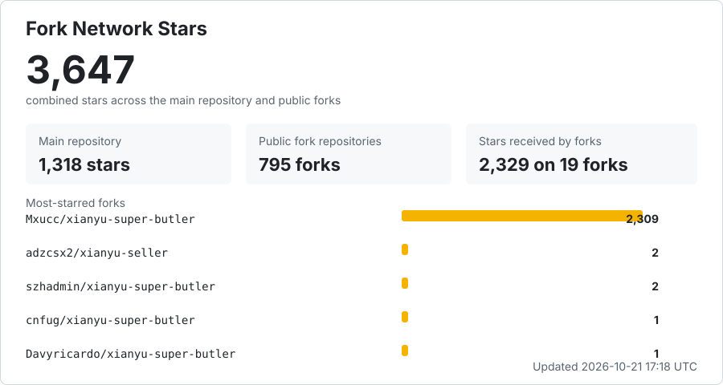

# 闲鱼智控（闲鱼超级管家）

面向闲鱼卖家的账号、商品、订单、消息、自动回复与自动发货一体化管理系统。
*一款能让你的想法'变现'的强大作品* 
### 推荐使用云端版（GPT6自动过滑块+人工巡检）
云端saas版本：https://xy.corleom.com/
**本项目征集PR、功能更新，任何一个提交PR的作者会在未来获得顶配模型token奖励**

[](https://github.com/23Star/xianyu-super-butler/stargazers)
[](https://github.com/23Star/xianyu-super-butler/releases)
[](https://www.python.org/)
[](https://react.dev/)
[](LICENSE)

**一个人把多个闲鱼账号做成一门自动运转的生意，让你的创意自动'变现'**

多账号统一托管，买家下单自动发卡密、自动确认收货、自动评价、自动求小红花、收货后自动致谢。
关键词和 AI 双层自动回复接住每一句咨询，商品与订单自动同步，滑块与人机验证自动处理。
从「盯着手机一个个回」变成「打开网页看数据」。

> **本仓库是 [`23Star/xianyu-super-butler`](https://github.com/23Star/xianyu-super-butler) 的个人复刻版（fork）。**
> 保留上游全部功能，并在其基础上增加了商品专属回复与售完自动重新上架，修复了若干上游 bug。
> 上游更新通过 `git fetch upstream && git merge upstream/main` 合并，不保证与上游实时同步。

- 🏪 **多账号管理** — 扫码即接入，一个后台管完所有小号，逐账号独立配置策略
- 📦 **自动发货** — 卡密自动发出，支持多规格、多数量，发货前风险拦截
- 💬 **自动回复** — 关键词精确命中 + AI 议价，可设最低价与议价轮数，绝不越线让价
- ⭐ **买家互动** — 确认收货后自动评价、自动求小红花、自动发送致谢文本
- 🤖 **商品自动化** — 商品同步、素材库、定时擦亮、自动上下架
- 📊 **经营看板** — 成交额、到账、退款、订单和库存一屏掌握，**历史订单可一次性拉回**

## 本复刻版与上游的不同

### 新增功能

- **商品专属自动回复**：在「商品」页为单个商品配置一段固定回复。
  - 支持「优先于关键词和 AI」开关：默认命中该商品直接回复，也可改为仅在关键词/AI 未命中时兜底。
  - 支持「同一会话只回复一次」开关：默认按 `(账号, 会话, 商品)` 只触发一次，之后的消息继续走关键词/AI/账号默认回复。
  - 支持 `{send_user_name}`、`{send_user_id}`、`{send_message}`、`{item_id}` 占位符。
- **付款后确认再发货**：买家付款后先发送自定义确认文案，买家回复配置的关键词后才扣库存、发卡密。
  - 账号级默认配置 + 商品级覆盖；默认关闭，老账号行为不变。
  - 关键词支持多个同义词（`|` 分隔）、包含匹配和排除词；同一会话多笔订单按最早一笔逐笔放行。
  - 等待超时默认 30 分钟，可配置提醒；超时只通知卖家，不自动发货。
  - 确认记录持久化，断线重连、订单同步补单不会绕过确认直接发卡；手动发货会取消待确认记录。
  - 订单页显示待确认列表，可重发文案、取消等待或转手动发货。
- **售完下架自动重新上架**：商品被同步标记为下架后，如果绑定的卡密仍可用，自动通过鱼小铺卖家工作台重新上架。
  - 走「商品管理 → 下架 → 编辑 → 设库存 → 发布」通道，发布后**商品 ID 不变**，自动发货绑定不会失效（2026-10-18 实测）。
  - 批量卡密按剩余行数判断，发完才不上架；上架时每个链接只挂 1 件，避免多个链接共用同一张卡时超卖。固定文本、图片、API 发卡有内容即可上架，按无限库存处理。
  - 逐商品开启 + 全局总开关，默认全部关闭。
  - 默认 dry-run，只记录候选不执行；不需要额外配置文件，也不用手动探测选择器。
  - 多规格商品采用严格模式：所有启用规格都满足条件才上架。
  - 上架前先用卖家端接口预刷新 Token（`_m_h5_tk` / `cookie2` / `sgcookie` / `_tb_token_`），落到登录页时自动重试一次。
  - 浏览器刷新出的 Cookie 会回写内存和数据库；浏览器 profile 持久化到 `data/relist_profiles/<账号ID>`，容器重建不丢。
  - 每 30 分钟检查一次卖家工作台登录态，失效时暂停自动上架并通过通知渠道提醒，重新登录后自动恢复。

### 修复的上游问题

- 商品专属回复跨账号串号：`get_default_reply` 中多了一次不带 `cookie_id` 的 `item_replay` 查询，会把 A 账号配置的回复串到 B 账号，并绕过占位符替换。
- `item_replay` 缺少 `(cookie_id, item_id)` 唯一约束，重复行会让 `fetchone` 结果不确定；已补唯一索引并改为原子 upsert。
- 商品回复列表的 JOIN 缺少 `cookie_id` 条件，同一商品 ID 在多个账号下会串标题或出现重复行。
- 前端关键词编辑会丢弃 `item_id`，编辑一次就会把商品专属关键词静默变成通用关键词。
- Windows + Playwright 1.60：滑块回退到内置 Chromium 时只查找 `chrome-win/chrome.exe`，而新版实际安装在 `chrome-win64/`，导致找不到浏览器。
- `PUT /item-reply/...` 使用裸 dict 且忽略数据库返回值，未校验商品是否属于该账号；已补 Pydantic 校验和归属校验。

### 工程改动

- 新增 `app/item_relist.py`、`utils/item_relist.py`、`scripts/probe_relist_page.py`（探针只读，不执行发布）。
- 新增商品专属回复、自动上架与付款后确认发货的回归测试；完整测试套件 442 个用例通过。
- 前端重新构建并提交 `static/` 产物。

> 使用前请阅读下方上游的部署与风险说明。本复刻版与上游一样，仅供学习、研究和合法自动化使用。


## 核心功能

| 模块 | 能力 |
| --- | --- |
| 总览 | 汇总营收、账号、订单、卡密库存和运行状态 |
| 账号 | 扫码、密码或 Cookie 登录，资料同步，监听任务状态，暂停和自动回复配置 |
| 商品 | 从闲鱼同步商品，维护本地详情、图片、规格、数量和商品回复 |
| 商品自动化 | 商品筛选、素材库、发布记录、定时删除、短链修复和补偿任务 |
| 订单 | 一键拉取闲鱼历史卖出订单，状态判定、详情补全、批量刷新、手动发货和异常保护 |
| 卡密 | 卡券分组、库存导入、状态管理、多规格和多数量发货 |
| 自动回复 | 账号关键词回复、默认回复和回复一次控制 |
| 人工智能回复 | 兼容 OpenAI 协议的大模型配置、上下文对话和测试 |
| 自动发货 | 全局、指定账号、指定商品三级发货规则及发货前风险拦截 |
| 消息管理 | 闲鱼会话列表、消息收发、搜索筛选、回复决策日志和过滤规则 |
| 通知与日志 | 通知渠道、账号绑定、风险日志和系统日志 |
| 设置 | 管理员账号与改密、注册与邮箱验证开关、服务、备份及系统配置 |
| 公告与更新 | 从自建地址拉取公告与版本信息，首页横幅提示，「关于」页手动检查更新 |

## 界面预览

### 账号管理：一个后台管完所有小号

扫码添加账号，实时显示监听状态。每个账号可独立设置自动确认、人工接入暂停时长、
是否启用 AI 回复，互不干扰。


### 商品与发货：卡密自动发到买家手上

同步在售商品，逐个商品绑定发货内容，支持多规格和多数量。已下架的商品会被标记出来
并默认隐藏，不和在售的混在一起。


### 订单管理：接入前的历史订单也能一次拉回来

「拉取卖出订单」会把闲鱼上的历史订单整批同步进来，不只是接入之后的新单，
所以刚部署就能看到完整的经营数据。状态、买家、实付金额和发货情况一目了然，
支持按账号和状态筛选，也能手动发货或补发。


### 买家互动：确认收货后的动作全部自动完成

评价买家、索要小红花、发送收货致谢，三项都能逐账号开关。买家一确认收货，
致谢立即发出，评价和求花在订单状态就绪后自动执行。


### 消息中心：所有账号的会话在一个页面里

跨账号会话列表，支持搜索和筛选，可以直接接管对话。自动回复的每一次决策都有日志，
能查到为什么回了、为什么没回。


## 如何部署

> **⚠️ 请勿部署到 Hugging Face Spaces 等共享托管平台**
>
> 本项目内置反检测浏览器（Patchright）、验证码处理（CAPTCHA/Geetest）与 Telegram 通知等组件，
> 这类组合极易被共享平台判定为滥用（platform abuse），已有多起导致账号被封、其他 Space 受牵连的先例。
> 此外，海外出口 IP 也会显著增加闲鱼自有风控的触发概率。
> **推荐部署到本地设备、自有 VPS 或国内服务器。**

### 一条命令直接启动（最快，不用克隆仓库）

有 Docker 就能跑，不需要下载源码：

```bash
docker run -d --name xianyu-butler \
  -p 8080:8080 \
  -v $(pwd)/data:/app/data \
  -v $(pwd)/logs:/app/logs \
  -v $(pwd)/backups:/app/backups \
  -e ADMIN_USERNAME=admin \
  -e ADMIN_PASSWORD=改成你自己的密码 \
  --restart unless-stopped \
  ghcr.io/23star/xianyu-super-butler:latest
```

浏览器打开 `http://服务器IP:8080` 即可。数据都在当前目录的 `data` / `logs` / `backups` 里，
升级只需 `docker pull` 后重建容器，数据不丢。

Windows PowerShell 把 `$(pwd)` 换成 `${PWD}`，续行的 `\` 换成反引号 `` ` ``。

### Docker Compose（推荐长期使用）

```bash
git clone https://github.com/23Star/xianyu-super-butler.git
cd xianyu-super-butler
docker compose -f docker-compose.nas.yml up -d
```

同样是预构建镜像，不在本机编译任何东西，支持 amd64 / arm64。相比上面一条命令，
Compose 的好处是配置写在文件里、改起来清楚，升级也只有一行命令。

该配置不依赖 `.env`，管理员账号密码在 `docker-compose.nas.yml` 里的 `CHANGE_ME` 处直接改。

### NAS 与低配设备（飞牛 fnOS、群晖、威联通、软路由、低配 VPS）

**用上面那条命令，不要本地构建。**

`npm ci`、前端打包、Python 依赖编译和 Chromium 下载会同时抢占 CPU 和内存，
轻则卡十几分钟，重则内存不足被杀，反复重启表现为「装不上、机器卡死」。
预构建镜像已同时提供 amd64 和 arm64，绕开全部编译步骤。

```bash
docker compose -f docker-compose.nas.yml up -d
```

飞牛 fnOS、群晖等图形界面的 Docker 通常没地方放 `.env`，所以这份配置把变量直接写在
compose 文件里，改完 `CHANGE_ME` 就能用。

### Docker 本地构建（需要改代码时）

```bash
cp .env.example .env          # 不改也能启动，此时使用默认密码
docker compose up -d --build
```

国内网络用 CN 配置（apt、pip、npm、Chromium 全部走国内镜像）：

```bash
docker compose -f docker-compose-cn.yml up -d --build
```

可选 Nginx：`docker compose --profile with-nginx up -d --build`

### 源码运行（开发调试）

需要 Python 3.11+、Node.js 20+、npm。

```bash
git clone https://github.com/23Star/xianyu-super-butler.git
cd xianyu-super-butler

py -3.11 -m venv .venv
.\.venv\Scripts\Activate.ps1
python -m pip install -r requirements.txt
playwright install chromium

cd frontend && npm ci && npm run build && cd ..
python Start.py
```

### 访问

- 管理页面：`http://localhost:8080/`
- API 文档：`http://localhost:8080/docs`
- 健康检查：`http://localhost:8080/health`

默认管理员 **admin / admin123**，登录后请在「设置 → 账号与同步 → 修改登录密码」立即改掉。

数据持久化到 `./data`（数据库）、`./logs`（日志）、`./backups`（备份）。

### 更新

```bash
# 预构建镜像（推荐方式对应的更新命令）
docker compose -f docker-compose.nas.yml pull && docker compose -f docker-compose.nas.yml up -d

# 本地构建
git pull && docker compose up -d --build
```

> **滑块与人机验证、部署失败排查、使用流程** 见 [docs/deployment.md](docs/deployment.md)。
> 自动过滑块受平台风控限制不保证成功，自动失败时可在账号页转人工验证。

## 交流与反馈

<table>
  <tr>
    <th align="center">微信群</th>
    <th align="center">QQ群</th>
  </tr>
  <tr>
    <td align="center"></td>
    <td align="center"></td>
  </tr>
  <tr>
    <td align="center">二维码失效后会在仓库更新</td>
    <td align="center">群号：704866149</td>
  </tr>
</table>

缺陷和功能建议请提交到 [GitHub Issues](https://github.com/23Star/xianyu-super-butler/issues)。

## 许可与声明

本项目基于 [zhinianboke/xianyu-auto-reply](https://github.com/zhinianboke/xianyu-auto-reply) 二次开发并持续维护，保留原项目核心能力，同时重构管理端、账号监听、商品同步、订单处理和发货规则。感谢原作者的开源工作。

项目使用 [GNU Affero General Public License v3.0](LICENSE)。修改、部署或通过网络提供服务时，请遵守 AGPL-3.0 的源代码公开义务。

本项目仅供学习、研究和合法自动化使用。使用者应遵守法律法规及平台规则，并自行承担使用风险。

## Star History

<a href="https://www.star-history.com/?type=date&repos=23Star%2Fxianyu-super-butler">
  <picture>
    <source media="(prefers-color-scheme: dark)" srcset="https://api.star-history.com/chart?repos=23Star/xianyu-super-butler&type=date&theme=dark&legend=top-left&sealed_token=AhEE4dCbaUSe6lOSCJhYlDz04x4r2C14buYVYWlJVlulk23LKk5DgHZfMIumVkiNUPsbFO--8IX-0pXCfW8nyyEN3NStTE-16pBQggRCq6gsUZRlegeZdTbWWU-UPKWAWlnyyQyndGhz-lPX0HJrKxSCriOB1fiyJljBO7eNsd4xVYkrByhViWaPMCv9" />
    <source media="(prefers-color-scheme: light)" srcset="https://api.star-history.com/chart?repos=23Star/xianyu-super-butler&type=date&legend=top-left&sealed_token=AhEE4dCbaUSe6lOSCJhYlDz04x4r2C14buYVYWlJVlulk23LKk5DgHZfMIumVkiNUPsbFO--8IX-0pXCfW8nyyEN3NStTE-16pBQggRCq6gsUZRlegeZdTbWWU-UPKWAWlnyyQyndGhz-lPX0HJrKxSCriOB1fiyJljBO7eNsd4xVYkrByhViWaPMCv9" />
    
  </picture>
</a>

Star 历史曲线实时读取 GitHub 数据，不需要人工更新。

## Fork 网络总 Star

[](https://github.com/23Star/xianyu-super-butler/network/members)

该统计在主仓库 Star 之外累加全部公开 Fork 获得的 Star，每 6 小时自动刷新。由于同一用户可能同时 Star 多个仓库，此处是各仓库 Star 数之和，并非去重后的独立用户数。
